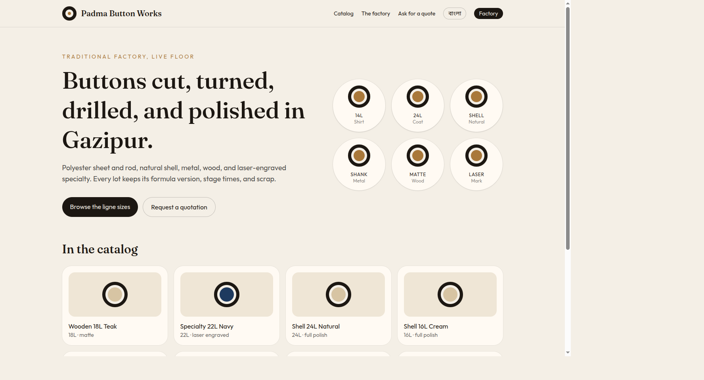
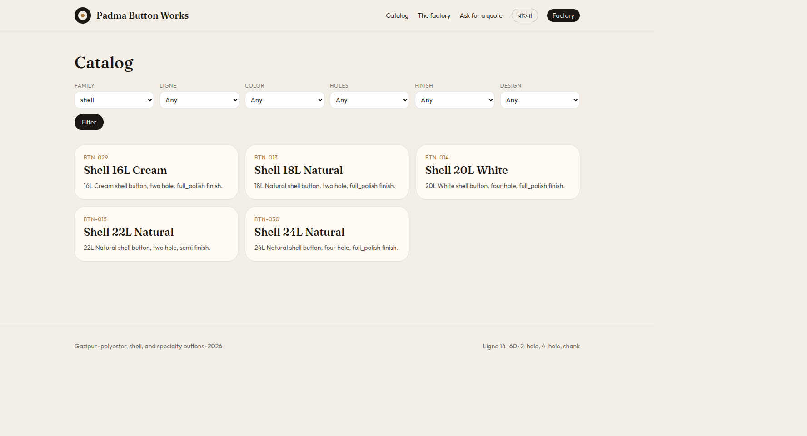
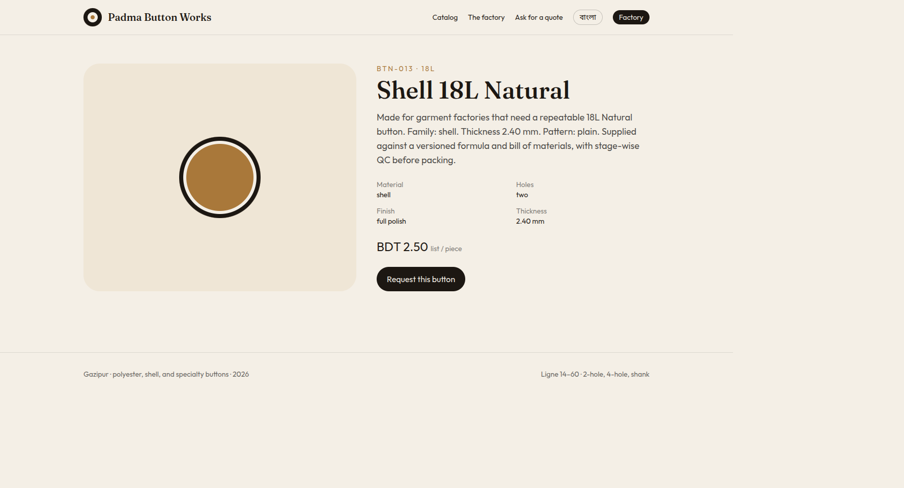
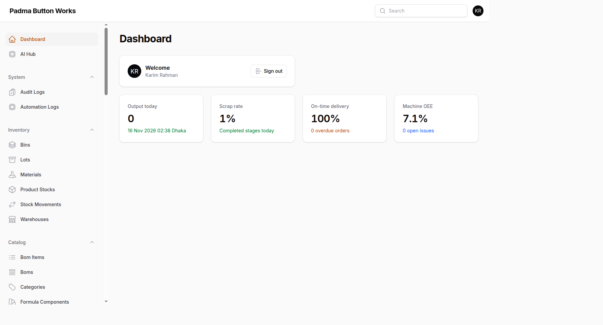
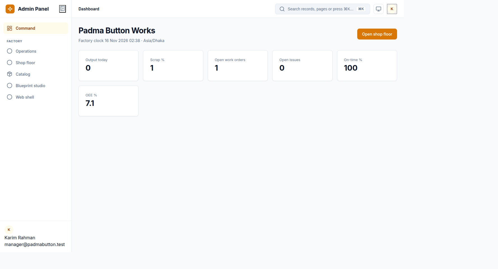
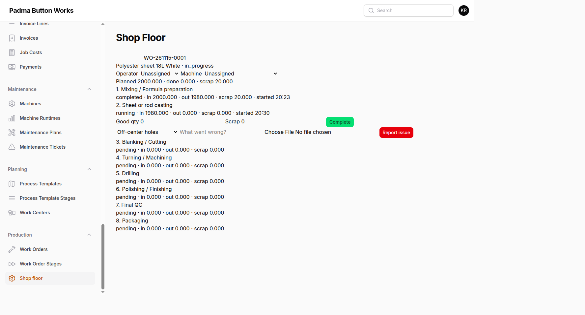

# Padma Button Works

A production system for a traditional button factory. Polyester sheet and rod, natural shell, metal, wood, and laser-engraved specialty stay on the same floor, in the same order a factory already uses. The software records every stage, prices every size, and opens the next action when scrap, color, stock, or a machine goes wrong.



Laravel 12 · PHP 8.3+ · Filament 4 · Tailwind CSS · Alpine.js · English and Bengali

The demo factory is **Padma Button Works**, Gazipur, timezone Asia/Dhaka, currency BDT.

## A buyer can see the range before they call

The public site is the front door for garment factories. Filters cover family, ligne (14L–60L), color, hole type, finish, and design. Each product has an English slug and a Bengali slug, a description, SEO fields, and schema.org JSON-LD.





A quotation form on the site becomes a sales inquiry in the office. Sales does not retype the email.

## The office sees the floor the same morning

Operations live in Filament. The command center shows the Dhaka clock, output, scrap, open orders, open issues, on-time delivery, and machine OEE.





## The floor still takes its time, and the record keeps up

A button is mixed, cast, blanked, turned, drilled, polished, inspected, and packed. Shell takes its own path: selection, punching, grinding, grooving, drilling, scraping, polishing and bleaching, then QC and packing. Each stage has a start, a stop, an operator, a machine, good quantity, scrap, and an issue button with a photo.



The next stage stays closed until the previous one is finished. That is how a real floor works, and the screen follows it.

## Time the desk gets back

These ranges are planning estimates for a single-site button works of roughly 30 to 80 people. They describe the clerical work this system replaces. They are not a measured customer study.

| Work that usually waits until evening | On paper | With this system |
| --- | --- | --- |
| A buyer asks for 18L ivory, 10,000 pieces | 30–60 minutes to open a lead and find the price break | The public form creates the inquiry, and the price break is already on the product |
| Mixing, drilling, and packing quantities | A chit collected at the end of the shift, typed the next morning | Start and stop on the shop floor, with good quantity and scrap on the stage |
| Resin or pearl falls under the minimum | Found when the mixer stops, then a phone call to the supplier | A purchase request is created as soon as on-hand stock crosses the minimum |
| Drilling scrap jumps | Noticed in the next morning's count | Above 8% scrap, or 50 pieces, the system files the issue, opens a calibration ticket, and can open a rework order |
| A shade does not match the swatch | Someone walks the batch back and hunts the formula book | The work order goes on QC hold, later stages block, and the active formula version is the one to review |
| A lathe or drill stops | The supervisor reallocates by memory | The machine is marked down, an urgent ticket opens, and pending stages move to another machine of the same type |
| Invoice, packing list, quality certificate | Laid out again in a word processor, including Bengali | One PDF each, with Unicode and Bengali, from the delivery, invoice, or inspection |
| "What did this order cost?" | Material from stores, hours from the time book, machine time guessed | Job cost from issued material, stage minutes, machine rate, and 15% overhead |
| Weekly production meeting | Four people assemble numbers from registers | Output, scrap, on-time orders, and OEE are already on the command center |

For a factory that still closes the books from registers, that is commonly **15 to 30 clerk-hours a week** returned to the floor and the sales desk: the production clerk's end-of-shift typing, the storekeeper's stock hunt before a purchase, and the accounts desk rebuilding the same invoice layout. The buttons still take the same hours to cast and polish. The system saves the hours spent finding out what happened.

## What the factory can do with it

- Publish a catalog a buyer can filter by ligne, material, color, holes, finish, and design, in English or Bengali.
- Turn a website inquiry into a lead, then a quotation, a sales order, a work order, a delivery, and an invoice.
- Run make-to-order for a garment program and make-to-stock for sizes you keep on the shelf. MRP nets finished stock on make-to-stock and explodes the bill of materials for what you still have to buy.
- Keep a polyester formula as percentages of resin, catalyst, accelerator, and pigment, with an obsolete version beside the active one.
- Cost a button from the real issue of material, the minutes on each stage, and the machine that ran.
- Hold a batch the moment the color drifts, and calibrate a drill the moment the holes wander.
- Receive supplier goods against a lot, value stock by FIFO or weighted average, and read a supplier invoice with OCR when a file is attached.
- Punch attendance from the office, track leave, overtime, and a skill matrix by department.
- Hand a future shop-floor phone app a small API: login, open orders, start, complete, report an issue.
- Switch a whole module off in config when a plant is not ready for it. Tables stay. Menus and permissions follow the flag.
- Add AI product copy, defect reading, and maintenance hints when you are ready to pay a provider. Until then the same buttons use local copy and shop-floor rules, so a demo never calls the network.

## The two process paths

**Polyester, metal, wood, and specialty**

1. Mixing and formula preparation
2. Sheet or rod casting
3. Blanking and cutting
4. Turning and machining
5. Drilling
6. Polishing and finishing
7. Final QC
8. Packaging

**Shell**

1. Shell selection
2. Punching
3. Grinding
4. Grooving
5. Drilling
6. Scraping
7. Polishing and bleaching
8. Final QC
9. Packaging

Expected minutes are stored per thousand buttons and become the schedule on the work order.

## Modules

Each module has migrations, models, policies, factories, and Filament screens. A role can view, manage, or delete only what `config/factory.php` allows. Super admin passes every check. Critical saves write an audit log.

### 1. Product and formula master

Button families: polyester sheet, polyester rod, shell, metal, wooden, specialty.

Attributes: ligne 14–60, thickness, holes (2, 4, or shank), design, finish (full polish, semi, matte, laser engraved), color.

Polyester formulas store resin, catalyst, accelerator, and pigment as percentages of batch weight. Version 1 can sit obsolete next to version 2. Bills of materials are per 1,000 buttons, can nest, and name the stage that consumes each line, with a scrap factor.

Price breaks follow quantity and finish, so a 10,000-piece coat button is not priced like a sample.

### 2. Inventory and warehouse

Raw materials cover unsaturated polyester resin, pigments, catalyst, accelerator, pearl, polishing media, shell blanks, and packaging. Lots and bins live under more than one warehouse. Receipts and issues are movements.

FIFO consumes the oldest lot at that lot's cost. Weighted average consumes the oldest lot physically and values the issue at the current average. When on-hand stock reaches the minimum, and no open request already covers that material, a purchase request is created and the manager and accountant are notified.

### 3. Production planning and MRP

A confirmed sales order plans itself. Make-to-stock subtracts finished goods already on hand. Make-to-order makes the full quantity. The plan releases a work order, schedules every stage from the template minutes, and raises one purchase request for materials the stores cannot cover.

### 4. Shop floor

The screen lists open work orders. The operator and machine are chosen, the stage is started, and it is completed with good quantity and scrap. A photo can ride with an issue. Stock for that stage is consumed from the bill of materials. The last stage receives finished goods and calculates job cost.

### 5. Quality

Incoming, in-process, and final inspections. Defect codes include off-center holes, cracked edges, thickness variation, color mismatch, bubbles, poor polish, chips, wrong size, and contamination. Non-conformance reports carry corrective and preventive actions. SPC samples sit on the stage. A photo on an issue is ready for image analysis when AI is enabled.

### 6. Machines and maintenance

Casting drums, rod lines, blanking presses, turning lathes, drilling machines, polishing barrels, laser engravers, and shell punches. Each machine has a preventive plan, a status, a capacity per hour, and an hourly rate. Breakdown tickets carry a priority and a suggested fix from history, with an AI hint when AI is on. OEE is availability, performance, and quality from recorded runtimes.

### 7. People

Departments: Mixing, Casting, Turning, Drilling, Polishing, QC, Packaging, Maintenance. Day and evening shifts. Skills on each worker. Leave and overtime. Attendance punches go through the attendance package as check-in and check-out, stored against the worker's code.

### 8. Sales

Customers, inquiries from the website, quotations, sales orders, deliveries. Pricing comes from the product's price breaks.

### 9. Procurement

Purchase request, then an RFQ (a purchase order in status `rfq`), then an issued order, then a goods receipt into a lot. Attach the supplier invoice and the receipt can extract the text with OCR.

### 10. Finance

Job cost is material plus labor plus machine time plus overhead. Invoices, packing lists, and quality certificates download as PDFs with Bengali support. Payments record money in and money out against the customer invoice or the supplier bill.

### 11. Reporting

The operations dashboard and the command center show output today, scrap rate, open work orders, open issues, on-time delivery, and average OEE. A reorder scan runs hourly. A production report job is scheduled for 18:00 factory time. Run `php artisan schedule:work` so those jobs actually fire.

### 12. Issue automation

| What happened | What the system does |
| --- | --- |
| Color mismatch | Holds the work order and blocks stages that have not started |
| Off-center holes, cracked edges, or a drilling-stage issue | Opens a calibration ticket on the drill |
| Scrap of 50 pieces or more | Opens a rework work order for that quantity |
| Scrap rate at or above 8% when a stage is completed | Files the issue itself (off-center holes on drilling, thickness variation elsewhere) |
| Bubbles | Points at catalyst ratio, mix time, and casting temperature, and notes if resin is already under minimum |
| Machine breakdown | Marks the machine down, opens an urgent ticket, moves pending stages to another machine of the same type |
| Material at or below minimum | Creates a purchase request and emails the manager and accountant |

Managers, QC, and the super admin get an in-app notification and an email. The demo mailer writes to the log, so nothing leaves the machine until you set a real mailer.

## Roles

| Role | Email | What they are for |
| --- | --- | --- |
| Super admin | super@padmabutton.test | Every module |
| Production manager | manager@padmabutton.test | Floor, stock, planning, maintenance |
| QC | qc@padmabutton.test | Inspections, issues, shop floor |
| Operator | operator@padmabutton.test | Shop floor. Cannot delete a product |
| Sales | sales@padmabutton.test | Customers, quotations, orders, catalog |
| Accountant | accounts@padmabutton.test | Invoices, payments, stock valuation, purchasing |
| HR | hr@padmabutton.test | Departments, shifts, leave, overtime, attendance |

Password for every demo account: `password`.

## Shop-floor API

For a later phone app on the floor.

```http
POST /api/v1/login
{ "email": "operator@padmabutton.test", "password": "password" }
```

Send the token as `Authorization: Bearer …`.

```http
GET  /api/v1/work-orders
POST /api/v1/stages/{id}/start
POST /api/v1/stages/{id}/complete
POST /api/v1/stages/{id}/issues
```

`start` accepts `operator_id` and `machine_id`. `complete` requires `qty_out` and `qty_scrap`. `issues` accepts `defect_code`, `description`, `severity`, and an optional photo.

## Where to click

| Place | Path |
| --- | --- |
| Public home, about, catalog, quote | `/` `/about` `/catalog` `/contact` |
| Language switch | `/locale/en` and `/locale/bn` |
| Operations | `/admin` |
| Shop floor | `/admin/shop-floor` |
| Command center | `/command` |
| Invoice, packing list, certificate PDFs | `/documents/invoices/{id}` and the matching packing and certificate routes, while signed in |
| Blueprint studio | `/blueprint-studio` |
| Web shell | `/webshell` only when `WEBSHELL_ENABLED=true` and the app is not in production |

Guests who open `/command` are sent to the Filament login.

## Demo data

`php artisan migrate --seed` loads:

- 32 published buttons across every family, with English and Bengali names and slugs
- Price breaks at 1,000 and 10,000 pieces
- Active and obsolete polyester formulas for white, black, and navy
- A bill of materials on every product
- 11 materials, two warehouses, a resin bay, and lots. White pigment has a second lot at a higher cost so weighted average is visible. Pearl essence is stocked below its minimum
- 14 machines with preventive plans due in 10 days
- 8 workers, skills, and a check-in for the drilling operator
- Haque Garments, a confirmed order for 2,000 white 18L shirt buttons, a released work order, mixing already closed at 1,980 good and 20 scrap, and an SPC thickness sample
- The pearl purchase request and an RFQ to Meghna Resin

## Install

```bash
composer install
cp .env.example .env
php artisan key:generate
touch database/database.sqlite
php artisan migrate --seed
php artisan storage:link
npm install
npm run build
php artisan serve
```

Open `/` for the catalog and `/admin` for the factory. Sign in as `manager@padmabutton.test` / `password`.

```bash
php artisan test
```

Tests use an in-memory database and keep AI and performance recording off. They cover FIFO, weighted average, shop-floor consumption, a color hold, a drilling calibration ticket, the public catalog, and an operator who cannot delete a product.

## MySQL or PostgreSQL

SQLite runs the demo with no database server. For a plant server:

```env
DB_CONNECTION=mysql
DB_HOST=127.0.0.1
DB_PORT=3306
DB_DATABASE=button_factory
DB_USERNAME=button
DB_PASSWORD=
```

PostgreSQL uses `DB_CONNECTION=pgsql` and port `5432`. Then `php artisan migrate --seed`.

## Turning AI on

Leave `FACTORY_AI_ENABLED=false` until a provider key is set. Product copy, defect advice, and maintenance hints then use local text and shop rules.

When you are ready:

```env
FACTORY_AI_ENABLED=true
```

Set the AI Hub provider and key in `.env`. Catalog generation, issue analysis, and invoice OCR then go through `imrandevbd/laravel-ai-hub`. If the provider fails, the factory falls back to the local copy and the same shop rules.

`DRUTOGOTI_ENABLED=true` starts request and query recording for bottleneck reports. Leave it off on a small demo.

`WEBSHELL_ENABLED` stays false. The web shell is an optional admin console. Do not enable it on a public server.

Modules are flags in `config/factory.php` under `modules`. Set one to `false` and its menus and writes stop. `access` lists which roles may view, manage, and delete.

## Packages

| Package | What it does here |
| --- | --- |
| `imrandevbd/laravel-admin-panel` | Command center at `/command`: theme, navigation, live KPIs |
| `filament/filament` 4 | Day-to-day records at `/admin` |
| `imrandevbd/laravel-ai-hub` | Multi-provider AI for defects and maintenance hints |
| `imrandevbd/laravel-ai-catalog` | Product copy, SEO, and JSON-LD when AI is on |
| `imrandevbd/laravel-ai-ocr` | Supplier invoice text on a goods receipt |
| `imrandevbd/laravel-attendance-hub` | Worker check-in and check-out |
| `imrandevbd/laravel-unicode-pdf` | Invoices, packing lists, and certificates, including Bengali |
| `imrandevbd/laravel-universal-slug` | English and Bengali product slugs |
| `imrandevbd/drutogoti` | Performance and bottleneck recording when enabled |
| `imrandevbd/tarikh` | Factory clock in Asia/Dhaka. The package's provider class is not in the published source, so discovery of that provider is disabled and the app calls `Tarikh\Tarikh` directly |
| `imrandevbd/laravel-filament-master` | Resource generators. The visual panel targets Filament 3, so it stays off on this Filament 4 app |
| `imrandevbd/laravel-blueprint-studio` | Module studio at `/blueprint-studio`, installed from Git because the Packagist archive commits were rewritten |
| `imrandevbd/laravel-webshell` | Optional server console |
| `laravel/sanctum` | Tokens for the shop-floor API |
